# Fase 0 — Auditoría previa a la ampliación ERP

Fecha: 2026-10-22. Rama: `feature/erp-fase-0` (desde `main`, `7c57168`).
Alcance: estado real del repositorio, bloqueadores para la ampliación a back-office de restauración, modelo de dominio propuesto y decisiones pendientes. No se ha modificado código.

## 0. Conflictos entre el encargo y el repositorio

| # | Conflicto | Qué prevalece / propuesta |
|---|---|---|
| C1 | `CLAUDE.md` define como "tarea actual" una auditoría pre-commit (solo informe). El encargo ERP es otra iniciativa. | La Fase 0 tampoco escribe código, así que no hay choque. Conviene actualizar la sección "Tarea actual" de `CLAUDE.md` antes de la Fase 1 (no lo toco: está sin versionar y es tuyo). |
| C2 | `CLAUDE.md` indica `./mvnw verify`; el encargo, `./mvnw test`. | Uso `./mvnw test` al cierre de fase. Cuando Flyway entre en juego, `verify` es más útil si se añaden tests de integración con failsafe. |
| C3 | El encargo nombra la entidad `ItemOrder`. En el código es `OrderItem` (tabla `order_items`). | Se usa el nombre real. |
| C4 | El encargo propone nombres de entidad en español (`Proveedor`, `ArticuloCompra`...). Todo el código está en inglés, y `docs/CAMBIOS.md` documenta que los enums se pasaron a inglés por coherencia. | Ver D6. Recomiendo código en inglés y documentación/UI en español. |
| C5 | El encargo pide verificar si hay seguridad real en backend "o solo filtrado por rol en UI". | Hay seguridad real (ver 2.3). La decisión pendiente 3 se reduce a extender lo existente. |

## 1. Estado real

### 1.1 Stack y build

| Elemento | Valor |
|---|---|
| Spring Boot | 4.1.1 (starters modulares: `spring-boot-starter-webmvc`, etc.) |
| Java | 17 |
| BD | PostgreSQL 17 (docker-compose), driver `postgresql` |
| Seguridad | `spring-boot-starter-security` + `oauth2-resource-server` (JWT HS256 propio) |
| Tests | JUnit 5, Mockito, `@WebMvcTest`, Testcontainers (PostgreSQL) |
| Frontend | React 19, Vite 7, react-router-dom 7, axios, lucide-react. ESLint 9 flat config |
| Migraciones | Ninguna. Sin Flyway ni Liquibase |

Línea base ejecutada hoy:

- `./mvnw test`: 44 tests, 40 OK, 0 fallos, 4 *skipped*. Los 4 omitidos son `BarAndGoCrmApplicationTests` (integración con Testcontainers, `disabledWithoutDocker = true`). Docker Desktop no estaba arrancado en esta máquina.
- `npm run build`: OK (348 kB JS, 106 kB gzip).
- `npm run lint`: sin errores.

### 1.2 Entidades y relaciones

| Entidad | Tabla | Campos relevantes | Relaciones |
|---|---|---|---|
| `User` | `users` | `email` único, `password` (BCrypt), `phone`, `role` (enum STRING), `dateOfCreation` | — |
| `Product` | `products` | `name` (no único), `description`, `price NUMERIC(10,2)`, `category VARCHAR(100)` libre, `available`, `imageUrl` | — |
| `Order` | `orders` | `dateOrder`, `timeTakeAway`, `total`, `status`, `paymentMethod` | `ManyToOne User` (LAZY), `OneToMany OrderItem` (cascade ALL, orphanRemoval) |
| `OrderItem` | `order_items` | `productName VARCHAR(200)`, `quantity INTEGER`, `unitPrice NUMERIC(10,2)` | `ManyToOne Order`. **Sin FK a `Product`** |
| `Reservation` | `reservations` | `date`, `time`, `pax`, `userName`, `userPhone`, `comments`, `status` | Ninguna. Se asocia al cliente por teléfono, no por FK |

Enums: `UserRole {CUSTOMER, ADMIN}`, `OrderStatus {CREATED, IN_PREPARATION, READY, DELIVERED, CANCELLED}`, `ReservationStatus {PENDING, CONFIRMED, CANCELLED}`, `PaymentMethod {CARD, CASH}`.

Convenciones observadas: entidades JPA sin Lombok, getters/setters explícitos, DTOs con Bean Validation y mensajes en español, servicios `interface` + `impl`, `@Transactional` a nivel de clase con `readOnly` en lecturas, `open-in-view=false`, excepciones de dominio traducidas en `GlobalExceptionHandler` con `validationErrors` por campo.

### 1.3 Endpoints

| Recurso | Endpoints | Acceso (`SecurityConfig`) |
|---|---|---|
| `/api/auth` | `POST login`, `POST register`, `GET me` | login/register públicos; `me` autenticado |
| `/api/products` | `GET /`, `GET /{id}`, `GET /available`, `GET /category/{c}`, `POST`, `PUT /{id}`, `PATCH /{id}/toggle-availability`, `DELETE /{id}` | GET público; escritura ADMIN |
| `/api/orders` | `POST`, `GET /me`, `GET /{id}`, `GET ?from&to`, `GET /upcoming`, `PATCH /{id}/status`, `DELETE /{id}`, `GET /user/{id}`, `GET /status/{s}` | crear, `/me` y `/{id}` autenticado (propiedad comprobada en servicio); resto ADMIN |
| `/api/reservations` | `POST`, `GET /me`, `PATCH /{id}/cancel`, `GET`, `GET /{id}`, `GET /upcoming`, `PUT /{id}`, `DELETE /{id}`, `GET /date/{d}`, `GET /status/{s}` | crear, `/me`, cancelar autenticado; resto ADMIN |
| `/api/users` | CRUD + `GET /email/{e}` | ADMIN |

### 1.4 Frontend

- Rutas (`App.jsx`): `/login`, `/`, `/admin`, `/admin/products`, `/admin/reservations`, `/admin/orders` (ADMIN); `/cliente`, `/cliente/checkout`, `/cliente/orders`, `/cliente/reservations`, `/cliente/reservations/new` (CUSTOMER).
- `ProtectedRoute` acepta **un solo** `requiredRole` y redirige con un ternario binario (`ADMIN ? '/admin' : '/cliente'`).
- El sidebar vive en `Navbar.jsx` (no hay layout admin propio); `AdminDashboard` enlaza a las tres secciones.
- `ConfirmModal` existe y es reutilizable (tipos success/error/warning, cancelación opcional).
- Errores por campo del backend: solo `ProductForm` lee `validationErrors`. No hay helper común.
- Categorías de producto hardcodeadas en `constants.js` y en `ProductList.jsx` (`ENTRANTES`, `PRINCIPALES`, `POSTRES`, `BEBIDAS`).
- Sesión (token + usuario) en `localStorage`.
- Sin tests de frontend.

### 1.5 Configuración de BD

| Perfil | `ddl-auto` | Observaciones |
|---|---|---|
| `dev` (por defecto) | `update` | `DataInitializer` carga demo si `users` está vacía |
| `prod` | `validate` | El esquema debe existir; hoy solo se crea arrancando antes en `dev` |
| `test` | `create` | Contenedor efímero |

Credenciales vía `.env` (no versionado; `.env.example` sí). `.gitignore` cubre Maven, Node/Vite, `.env*` e IDE.

### 1.6 Tests

Unitarios con Mockito para `AuthServiceImpl`, `OrderServiceImpl`, `ReservationServiceImpl`, `TokenService`, `ReservationSchedule`; `SecurityRulesTest` (`@WebMvcTest`) con 12 casos de autorización; 4 de integración con Testcontainers. No hay tests de `ProductService` ni de `UserService`.

## 2. Bloqueadores y riesgos para la ampliación

### 2.1 Verificaciones pedidas

| Punto | Resultado | Impacto |
|---|---|---|
| ¿`OrderItem` referencia `Product` por FK? | **No.** Solo `productName` + `unitPrice` como snapshot. | Bloqueador para Fase 5 (descuento por venta) y Fase 6 (ingeniería de menú). El snapshot es correcto y se mantiene; falta la FK. |
| ¿`Product.category` es enum o entidad? | **String libre** (`VARCHAR(100)`), valores fijados por convención en frontend. | Bloquea informes por familia y ordenación de carta. Migrable con datos actuales (4 valores). |
| ¿Seguridad real en backend? | **Sí.** Resource server JWT, reglas por ruta y método en `SecurityConfig`, comprobación de propiedad en servicios, `SecurityRulesTest` cubriéndolo. | No es bloqueador. Requiere extender roles (ver D2/D3). |
| `ddl-auto` | `update` en dev, `create` en test, `validate` en prod. | El encargo lo prohíbe. Fase 1 lo sustituye por Flyway + `validate` en todos los perfiles. |
| Estrategia de IDs | `IDENTITY` (`BIGSERIAL`) en todas las entidades. | Funciona. Desactiva el batch insert de Hibernate; irrelevante para los volúmenes previstos. Se mantiene por coherencia. |
| Concurrencia (`@Version`) | **Ninguna entidad la tiene.** | Riesgo real en cuanto haya stock: dos cambios de estado simultáneos del mismo pedido podrían descontar stock dos veces. |

### 2.2 Bloqueadores adicionales detectados

| # | Hallazgo | Dónde | Por qué bloquea | Propuesta |
|---|---|---|---|---|
| B1 | Transición de estado de pedido libre en backend: se acepta cualquier `status` (p. ej. `DELIVERED → CREATED`). El flujo lineal solo existe en `OrderList.jsx`. | `OrderServiceImpl.updateOrderStatus` | Fase 5 dispara el descuento al entrar en `DELIVERED`; sin máquina de estados no se puede garantizar idempotencia ni compensación. | Máquina de estados en backend (D9). |
| B2 | `DELETE /api/orders/{id}` hace borrado físico. | `OrderServiceImpl.deleteOrder` | Un pedido con movimientos de stock asociados no puede desaparecer: rompe la trazabilidad del ledger. | Prohibir borrado si hay movimientos; usar `CANCELLED` (D8). |
| B3 | `DELETE /api/products/{id}` hace borrado físico. | `ProductServiceImpl.deleteProduct` | Con FK desde `order_items` y desde escandallos, el borrado fallará (409 por `DataIntegrityViolationException`) o, con `ON DELETE SET NULL`, perderá trazabilidad. | Baja lógica (D7). |
| B4 | `Product.name` no es único. | `Product` | La migración de datos de `order_items` "por coincidencia de nombre" puede ser ambigua. | Resolver solo coincidencias exactas y únicas; el resto se registra como no resuelto (ver Fase 1). |
| B5 | Orden de fases incoherente: la recepción de Fase 2 genera movimientos de Fase 3, y la sugerencia de reposición de Fase 2 necesita stock actual, que no existe hasta Fase 3. | Encargo | No se puede cerrar Fase 2 con esos dos puntos funcionando. | Reordenar (D10). |
| B6 | Docker no disponible en esta máquina: los tests de integración se omiten. | Entorno | Las migraciones Flyway solo se validan de verdad contra PostgreSQL. Sin Docker, `./mvnw test` pasará en verde sin haber ejecutado una sola migración. | Arrancar Docker Desktop antes de cerrar Fase 1. Lo considero requisito, no opcional. |
| B7 | La única fuente de ventas son los pedidos *take away* de la web. No hay TPV (fuera de alcance). | Dominio | En un bar real la mayoría de ventas pasan por caja. El consumo teórico saldrá muy por debajo del real y la desviación no significará nada operativamente. | Aceptable para portfolio si se documenta. Anotado en backlog: importación de ventas agregadas (CSV por producto y día). |
| B8 | `CurrentUser.isAdmin()` decide el acceso a recursos ajenos. `ProtectedRoute` asume dos roles. | Backend y frontend | Al añadir MANAGER/STAFF, un encargado no podría ver pedidos ajenos y un trabajador sería redirigido a `/cliente`. | Se resuelve junto con los roles (D2). |
| B9 | `UserServiceImpl` deja asignar cualquier rol a quien tenga acceso a `/api/users`. | `UserServiceImpl.createUser/updateUser` | Con un rol MANAGER con acceso a usuarios, podría autoascenderse o crear ADMIN. | Regla explícita: solo ADMIN asigna ADMIN/MANAGER. |
| B10 | Fechas con `LocalDateTime` (sin zona) en todo el modelo. | Entidades | Para un ledger y para informes por periodo conviene un instante absoluto. | Tablas nuevas con `timestamptz` + `Instant`. Las existentes no se tocan (fuera de alcance). |

### 2.3 Riesgos de seguridad (documentados, no se resuelven salvo confirmación)

- El rol viaja en el JWT y no se revalida contra BD: degradar a un usuario no surte efecto hasta que caduca el token (2 h por defecto). Para endpoints de inventario es aceptable si se documenta; la alternativa (consultar BD en cada petición o lista de revocación) añade coste sin beneficio claro en un proyecto de este tamaño.
- Token en `localStorage`: expuesto a XSS. Mitigación real sería cookie `HttpOnly` + CSRF. Fuera de esta iniciativa → backlog.
- No hay refresh token: la sesión expira a las 2 h. Aceptable.
- Las nuevas rutas `/api/erp/**` (o equivalentes) caen hoy en `anyRequest().authenticated()`: **un CUSTOMER autenticado tendría acceso** si no se añaden reglas. Por eso las reglas de rol de ERP deben entrar en la misma fase que el primer endpoint ERP, con test en `SecurityRulesTest`.

## 3. Modelo de dominio propuesto

Nombres en inglés en código y tablas (sujeto a D6). Glosario:

| Encargo | Código | Encargo | Código |
|---|---|---|---|
| UnidadMedida | `UnitOfMeasure` | MovimientoStock | `StockMovement` |
| ConversionUnidad | `UnitConversion` | Saldo de stock | `StockBalance` |
| Proveedor | `Supplier` | Valoración PMP | `StockValuation` |
| CategoriaArticulo | `ItemCategory` | Lote | `StockLot` |
| Categoría de carta | `ProductCategory` | RecuentoInventario | `StockCount` |
| ArticuloCompra | `StockItem` | Escandallo | `Recipe` |
| ArticuloProveedor | `StockItemSupplier` | Histórico de coste | `RecipeCostHistory` |
| Tipo de IVA | `VatRate` | Orden de producción | `ProductionBatch` |
| PedidoProveedor | `PurchaseOrder` | Merma | `Waste` |
| Albarán | `GoodsReceipt` | Local | `Site` |
| Almacén | `Warehouse` | Histórico de precio | `PurchasePriceHistory` |

### 3.1 Diagrama ER

```mermaid
erDiagram
    %% ---------- Existente ----------
    USERS ||--o{ ORDERS : "realiza"
    ORDERS ||--|{ ORDER_ITEMS : "contiene"
    PRODUCTS |o--o{ ORDER_ITEMS : "product_id (F1, nullable)"

    %% ---------- Fase 1 ----------
    PRODUCT_CATEGORY ||--o{ PRODUCTS : "clasifica (F1)"
    UNIT_OF_MEASURE ||--o{ UNIT_CONVERSION : "from_unit"
    UNIT_OF_MEASURE ||--o{ UNIT_CONVERSION : "to_unit"
    USERS ||--o{ USER_TAG : "etiquetas (F1, D2)"

    %% ---------- Fase 2 ----------
    ITEM_CATEGORY ||--o{ STOCK_ITEM : "clasifica"
    VAT_RATE ||--o{ STOCK_ITEM : "IVA compra"
    VAT_RATE ||--o{ PRODUCTS : "IVA venta (F4)"
    UNIT_OF_MEASURE ||--o{ STOCK_ITEM : "compra / inventario / uso"
    STOCK_ITEM |o--o{ UNIT_CONVERSION : "conversion propia (1 caja = 24 ud)"
    STOCK_ITEM ||--o{ STOCK_ITEM_ALLERGEN : "alergenos (14 UE)"
    STOCK_ITEM ||--o{ STOCK_ITEM_SUPPLIER : "proveedores y precio"
    SUPPLIER ||--o{ STOCK_ITEM_SUPPLIER : ""
    SUPPLIER |o--o{ STOCK_ITEM : "habitual"
    SUPPLIER ||--o{ PURCHASE_ORDER : ""
    PURCHASE_ORDER ||--|{ PURCHASE_ORDER_LINE : ""
    STOCK_ITEM ||--o{ PURCHASE_ORDER_LINE : ""

    %% ---------- Fase 3 ----------
    SITE ||--|{ WAREHOUSE : "multi-local preparado"
    SUPPLIER ||--o{ GOODS_RECEIPT : ""
    PURCHASE_ORDER |o--o{ GOODS_RECEIPT : "puede no haber pedido"
    WAREHOUSE ||--o{ GOODS_RECEIPT : "destino"
    GOODS_RECEIPT ||--|{ GOODS_RECEIPT_LINE : ""
    PURCHASE_ORDER_LINE |o--o{ GOODS_RECEIPT_LINE : "recibido vs pedido"
    STOCK_ITEM ||--o{ GOODS_RECEIPT_LINE : ""
    GOODS_RECEIPT_LINE |o--o| STOCK_LOT : "lote y caducidad"
    STOCK_ITEM ||--o{ PURCHASE_PRICE_HISTORY : ""
    SUPPLIER ||--o{ PURCHASE_PRICE_HISTORY : ""
    STOCK_ITEM ||--o{ STOCK_MOVEMENT : ""
    WAREHOUSE ||--o{ STOCK_MOVEMENT : ""
    STOCK_LOT |o--o{ STOCK_MOVEMENT : ""
    USERS ||--o{ STOCK_MOVEMENT : "autor"
    STOCK_MOVEMENT |o--o| STOCK_MOVEMENT : "reverses_movement_id"
    STOCK_ITEM ||--o{ STOCK_BALANCE : "(item, warehouse)"
    WAREHOUSE ||--o{ STOCK_BALANCE : ""
    STOCK_ITEM ||--o{ STOCK_VALUATION : "PMP (item, site)"
    SITE ||--o{ STOCK_VALUATION : ""
    WAREHOUSE ||--o{ STOCK_COUNT : ""
    STOCK_COUNT ||--|{ STOCK_COUNT_LINE : "teorico vs contado"
    STOCK_ITEM ||--o{ STOCK_COUNT_LINE : ""

    %% ---------- Fase 4 ----------
    PRODUCTS |o--o| RECIPE : "plato o bebida"
    STOCK_ITEM |o--o| RECIPE : "elaboracion inventariable"
    RECIPE ||--|{ RECIPE_LINE : ""
    STOCK_ITEM |o--o{ RECIPE_LINE : "ingrediente"
    RECIPE |o--o{ RECIPE_LINE : "sub_recipe_id"
    UNIT_OF_MEASURE ||--o{ RECIPE_LINE : "unidad de uso"
    RECIPE ||--o{ RECIPE_COST_HISTORY : ""
    RECIPE ||--o{ PRODUCTION_BATCH : ""
    WAREHOUSE ||--o{ PRODUCTION_BATCH : ""

    %% ---------- Fase 5 ----------
    STOCK_ITEM |o--o{ WASTE : "merma de articulo"
    PRODUCTS |o--o{ WASTE : "merma de plato"
    WAREHOUSE ||--o{ WASTE : ""
    USERS ||--o{ WASTE : ""
    ORDERS ||--o| ORDER_STOCK_POSTING : "idempotencia"

    STOCK_MOVEMENT {
        bigint id PK
        varchar type "PURCHASE_RECEIPT, SALE, WASTE, COUNT_ADJUSTMENT, TRANSFER, PRODUCTION_CONSUMPTION, PRODUCTION_OUTPUT"
        bigint stock_item_id FK
        bigint warehouse_id FK
        bigint lot_id FK "nullable"
        numeric quantity "con signo, unidad de inventario, (18,4)"
        numeric unit_cost "PMP o coste de entrada, (19,6)"
        numeric total_cost "(18,4)"
        varchar source_type "ORDER, GOODS_RECEIPT, WASTE, STOCK_COUNT, TRANSFER, PRODUCTION"
        bigint source_id
        bigint source_line_id "nullable"
        bigint reverses_movement_id FK "nullable"
        bigint user_id FK
        timestamptz occurred_at
        timestamptz recorded_at
    }
    STOCK_BALANCE {
        bigint stock_item_id PK
        bigint warehouse_id PK
        numeric quantity
        timestamptz updated_at
    }
    STOCK_VALUATION {
        bigint stock_item_id PK
        bigint site_id PK
        numeric quantity_on_hand
        numeric avg_cost "PMP (19,6)"
        bigint version
    }
    RECIPE {
        bigint id PK
        bigint product_id FK "unique, null en elaboraciones"
        bigint stock_item_id FK "null si no inventariable"
        varchar type "DISH, PREPARATION"
        numeric portions
        numeric yield_quantity "elaboraciones"
        bigint yield_unit_id FK
        numeric target_food_cost_pct "null = valor global"
        bigint version
    }
    RECIPE_LINE {
        bigint id PK
        bigint recipe_id FK
        bigint stock_item_id FK "exactamente uno de los dos"
        bigint sub_recipe_id FK "exactamente uno de los dos"
        numeric gross_quantity
        bigint unit_id FK
        numeric yield_pct "rendimiento tras limpieza"
    }
```

### 3.2 Reglas de modelo transversales

- **Ledger inmutable.** `stock_movement` sin `UPDATE` ni `DELETE`: se refuerza en BD con un trigger que lanza excepción, no solo en la capa de servicio. Las correcciones son movimientos nuevos con `reverses_movement_id`.
- **Saldo derivado y mantenido.** `stock_balance` se actualiza en la misma transacción que el movimiento, con `SELECT ... FOR UPDATE` sobre la fila `(item, warehouse)` y bloqueo en orden fijo `(stock_item_id, warehouse_id)` para evitar *deadlocks* en explosiones de escandallo. Un test de reconciliación comprueba `saldo = SUM(movimientos)`. Elegido frente a una vista: los informes leen el saldo constantemente y la vista recalcularía todo el histórico.
- **Precisión.** Cantidades `NUMERIC(18,4)`, costes unitarios `NUMERIC(19,6)`, importes `NUMERIC(18,4)` internos y redondeo a 2 decimales solo al presentar. `RoundingMode.HALF_UP` en importes. Sin `double` en ningún cálculo.
- **`@Version`** en: `Order` (cambios de estado concurrentes), `Product`, `Supplier`, `StockItem`, `PurchaseOrder`, `GoodsReceipt`, `StockCount`, `Recipe`, `StockValuation`. No en `StockBalance` (bloqueo pesimista; con optimista habría reintentos constantes en horas punta).
- **Idempotencia de ventas.** Tabla `order_stock_posting (order_id PK, posted_at, reversed_at)` más índice único parcial en `stock_movement (source_type, source_id, source_line_id, stock_item_id) WHERE reverses_movement_id IS NULL`. Doble red: la tabla documenta el estado y el índice impide el duplicado aunque falle la lógica.
- **Multi-local.** `site` con una única fila sembrada por migración. `warehouse.site_id` obligatorio; los documentos llegan al local a través del almacén. Ningún endpoint filtra por local todavía.
- **Elaboraciones.** Una elaboración inventariable (fondo, salsa) es a la vez `Recipe(type=PREPARATION)` y `StockItem` de tipo elaborado, para que `PRODUCCION_ALTA` tenga dónde sumar.

### 3.3 Valoración PMP (D1 ya decidida)

PMP perpetuo por `(artículo, local)`:

- Entrada valorada (`ENTRADA_COMPRA`, `PRODUCCION_ALTA`): `pmp = (q_prev * pmp_prev + q_in * c_in) / (q_prev + q_in)`.
- Si `q_prev <= 0`: `pmp = c_in` (evita PMP negativos o infinitos con stock negativo).
- Salidas (`SALIDA_VENTA`, `MERMA`, `PRODUCCION_CONSUMO`, ajustes negativos): valoradas al PMP vigente, no lo modifican.
- Ajustes positivos de inventario: al PMP vigente, no lo modifican.
- `TRASPASO` entre almacenes del mismo local: no modifica el PMP (por eso el PMP es por local y no por almacén).
- Corrección de precio de un albarán ya confirmado: no se recalcula el histórico. Se registra un ajuste de valoración y el PMP se corrige hacia delante. Recalcular hacia atrás obliga a revalorar todas las salidas posteriores y a reescribir informes cerrados.

## 4. Decisiones pendientes

### Las cinco del encargo

| # | Tema | Recomendación | Justificación | Afecta modelo |
|---|---|---|---|---|
| D1 | Valoración de stock | **PMP perpetuo por (artículo, local)**, reglas en 3.3. | Ya elegido. FIFO exigiría capas de coste por lote y consumo por capa; PMP es el estándar en hostelería española y suficiente para food cost. | Sí (`stock_valuation`) |
| D2 | Roles | `ADMIN`, `MANAGER` (encargado), `STAFF` (trabajador), `CUSTOMER`. Las etiquetas del trabajador como atributo informativo (`user_tag`: COCINA, SALA, BARRA, OFFICE...) **sin efecto en permisos** en esta iniciativa. Matriz abajo. | Permisos por etiqueta multiplican la matriz de seguridad y los tests sin valor claro para un local pequeño. Si más adelante una etiqueta debe dar permisos, se convierte en *authority* sin cambiar el modelo. | Sí (enum + `user_tag`) |
| D3 | Seguridad backend | **Entra en esta iniciativa, en Fase 1.** Ya existe Spring Security + JWT; lo que falta es: nuevos roles en `SecurityConfig`, `@PreAuthorize` por método en servicios ERP, sustituir `isAdmin()` por comprobaciones por rol, regla B9 de asignación de roles y casos en `SecurityRulesTest`. | Dejarlo al backlog deja los endpoints ERP abiertos a cualquier CUSTOMER autenticado (2.3). Coste estimado: bajo, porque la infraestructura ya está. | No |
| D4 | Multi-local | `site` + `warehouse.site_id` + PMP por `(item, site)`. Una fila sembrada, sin UI ni filtros. | Añadir `site_id` después obligaría a migrar saldos y valoración. Añadirlo ahora en dos tablas cuesta casi nada. No se añade `site_id` a pedidos de venta ni a usuarios. | Sí |
| D5 | Fuera de alcance | Confirmado: caja y cierre diario, personal y turnos, APPCC, facturación electrónica, TPV externo. Anotado en `docs/backlog.md`. | — | No |

Matriz de permisos propuesta (D2):

| Área | ADMIN | MANAGER | STAFF | CUSTOMER |
|---|---|---|---|---|
| Usuarios | Todo | Crear/editar STAFF y CUSTOMER | — | — |
| Configuración (IVA, unidades, food cost objetivo) | Todo | Lectura | — | — |
| Carta y escandallos | Todo | Todo | Lectura sin costes | Carta pública |
| Proveedores y artículos | Todo | Todo | Lectura sin precios | — |
| Pedidos a proveedor | Todo | Todo | — | — |
| Recepción de albaranes | Todo | Todo | Registrar (sin confirmar precio distinto del pedido) | — |
| Mermas | Todo | Todo | Registrar | — |
| Recuentos | Todo | Abrir y cerrar | Contar líneas | — |
| Ajustes manuales y traspasos | Todo | Todo | Traspasos | — |
| Informes de coste | Todo | Todo | — | — |
| Pedidos de venta (estado) | Todo | Todo | Cambiar estado | Los suyos |
| Reservas | Todo | Todo | Consultar y confirmar | Las suyas |

### Decisiones adicionales detectadas en la auditoría

| # | Tema | Recomendación | Justificación | Afecta modelo |
|---|---|---|---|---|
| D6 | Idioma de entidades y tablas | Inglés en código, tablas y enums; español en documentación, UI y mensajes de validación (glosario en 3). | Coherente con el código existente y con la decisión ya documentada en `docs/CAMBIOS.md`. Mezclar `Order` con `PedidoProveedor` en el mismo paquete es lo peor de ambas opciones. Valores de enum del encargo (`ENTRADA_COMPRA`, `CADUCIDAD`...) se traducen igualmente (`PURCHASE_RECEIPT`, `EXPIRED`...), con etiquetas en español en frontend como ya se hace con `ORDER_STATUS_LABELS`. | Sí (nombres) |
| D7 | Borrado de `Product` | Baja lógica: campo `active` (distinto de `available`, que es "disponible hoy"). `DELETE` devuelve 409 si el producto tiene ventas o escandallo; si no, borra. FK `order_items.product_id` sin `ON DELETE`. | Mantiene trazabilidad sin impedir limpiar productos creados por error. | Sí |
| D8 | Borrado de `Order` | Prohibido (409) si existe `order_stock_posting`. Se mantiene para pedidos sin efecto en stock. | El ledger referencia el pedido como documento origen. | No |
| D9 | Máquina de estados de pedido | `CREATED → IN_PREPARATION → READY → DELIVERED`; `CANCELLED` desde cualquier estado no final; `DELIVERED → CANCELLED` permitido solo a ADMIN/MANAGER y genera compensación. Resto de transiciones: 400. Se implementa en **Fase 5**, junto al descuento. | Es la base de la idempotencia. Hoy el frontend ya sigue ese flujo, así que el cambio no rompe la UI. | No |
| D10 | Orden de fases | Mover **albarán de recepción** y **sugerencia de reposición** de Fase 2 a Fase 3, después del ledger. Fase 2 queda: artículos, IVA, alérgenos, proveedores y precios, pedidos a proveedor. | Ambas dependen de movimientos y stock actual (B5). Alternativa: adelantar almacén y ledger a Fase 2, que la deja muy grande. | No |
| D11 | Stock negativo | Permitido en `SALIDA_VENTA` y `PRODUCCION_CONSUMO` (con alerta). Bloqueado en mermas manuales y traspasos. | Un plato servido no se puede "rechazar" porque el teórico diga cero: el teórico es el que está mal. En operaciones manuales sí tiene sentido impedirlo. | No |
| D12 | Profundidad de lotes | Lote y caducidad registrados en la entrada; las salidas consumen lotes por FEFO automáticamente y de forma informativa (para alertas de caducidad). La valoración sigue siendo PMP. | Permite alertas de "próximo a caducar" con cantidades reales sin pedir al personal que elija lote en cada venta. | Sí |
| D13 | Sub-escandallos en la venta | Si la elaboración es inventariable, la venta consume el stock del intermedio. Si no, se explota recursivamente hasta materia prima. Flag `stock_item_id` presente/ausente en `recipe`. | Refleja cómo trabaja una cocina (la salsa se hace por la mañana, el plato se monta al pedido) y evita doble descuento con `PRODUCCION_CONSUMO`. | Sí |
| D14 | IVA de venta | `Product.price` incluye IVA (práctica habitual en carta). `Product.vat_rate_id` en Fase 4, por defecto el 10 % vía tabla `vat_rate`, nunca hardcodeado. | Food cost % se calcula sobre PVP sin IVA. | Sí |
| D15 | Consumo real | Consumo real = stock **contado** inicial + compras − stock **contado** final. Requiere dos recuentos cerrados que delimiten el periodo. | Si el stock inicial y final se derivan del ledger, el consumo real coincide por construcción con el teórico más mermas y ajustes: la desviación sería siempre cero. | No |
| D16 | Categorías | Dos entidades: `ProductCategory` (carta: entrantes, postres...) en Fase 1, migrando los cuatro valores actuales; `ItemCategory` (compras: carnes, limpieza...) en Fase 1 sin datos de uso hasta Fase 2. | Son taxonomías distintas con usuarios distintos. Una tabla con discriminador ahorra poco y complica validaciones. Coste: `ProductDTO.category` pasa a `categoryId` y cambian `ProductForm`, `ProductList` y `constants.js`. | Sí |
| D17 | Conversiones por artículo en Fase 1 | Fase 1 crea `unit_conversion` genérica y el servicio de conversión con tests de conversión por artículo sobre objetos de dominio. La columna `stock_item_id` y su FK se añaden en Fase 2 con migración. | `StockItem` no existe en Fase 1. Crear la columna sin tabla destino deja una FK pendiente sin garantía. | Sí |

## 5. Plan de fases ajustado (si se aceptan D3, D10, D16 y D17)

| Fase | Contenido |
|---|---|
| 1 | Flyway (V1 baseline + `validate` en dev/test/prod), `UnitOfMeasure`, `UnitConversion` + servicio y tests, `Supplier`, `ProductCategory` (+ migración de datos), `ItemCategory`, `@Version` en entidades existentes, `order_items.product_id` + migración por nombre con registro de no resueltos, roles `MANAGER`/`STAFF` + `user_tag` + reglas de seguridad y tests, `ProtectedRoute` con varios roles. |
| 2 | `VatRate`, `StockItem` (+ alérgenos, conversiones propias), `StockItemSupplier`, `PurchaseOrder` + líneas y estados. |
| 3 | `Site`, `Warehouse`, `StockMovement` (trigger de inmutabilidad), `StockBalance`, `StockValuation` (PMP), `StockLot`, `GoodsReceipt` (entrada, último precio, histórico), sugerencia de reposición, `StockCount`, alertas de caducidad. |
| 4 | `Recipe` + líneas, sub-escandallos con detección de ciclos, costes, histórico, alérgenos propagados, `Product.vat_rate_id`, producción. |
| 5 | Máquina de estados de pedido, descuento idempotente y compensación, `Waste`, consumo teórico vs real. |
| 6 | Informes y frontend de gestión. |

Notas técnicas para Fase 1:

- Spring Boot 4 usa starters modulares: Flyway necesita `spring-boot-starter-flyway` (no basta con `flyway-core`) más `flyway-database-postgresql`. A verificar contra la documentación de 4.1 al implementarlo.
- V1 se genera a partir del esquema que produce Hibernate hoy y se revisa a mano. Las BD de desarrollo existentes se adoptan con `baseline-on-migrate=true` y `baseline-version=1`; después se valida con `ddl-auto=validate`.
- `DataInitializer` se mantiene para datos de demo en `dev`; el esquema ya no depende de él.
- Fase 3 es la más grande. Si al detallarla supera lo razonable para una rama, propondré partirla en 3a (ledger, almacenes, albarán) y 3b (recuentos, caducidad, reposición).

## 6. Siguiente paso

Confirmar o corregir D2 (matriz y etiquetas), D3, D6, D7, D10, D12, D13, D14 y D16, que afectan al modelo de datos o al plan. El resto tiene opción por defecto y puede confirmarse en bloque.
